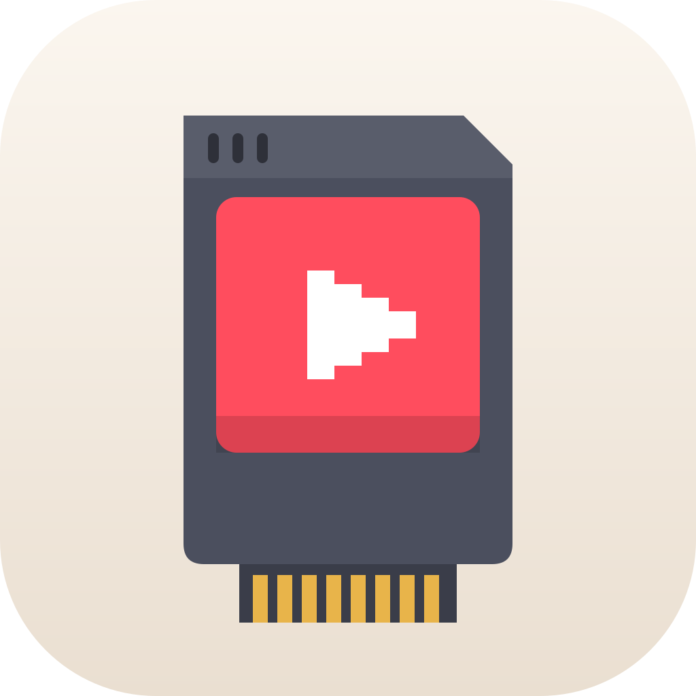
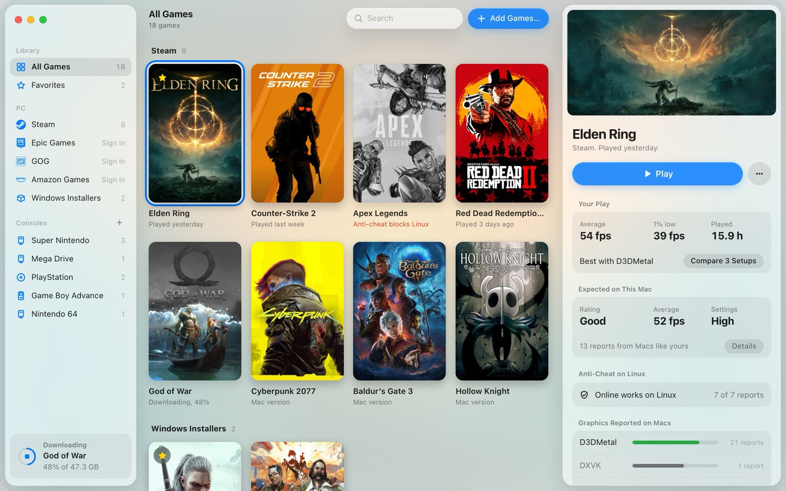
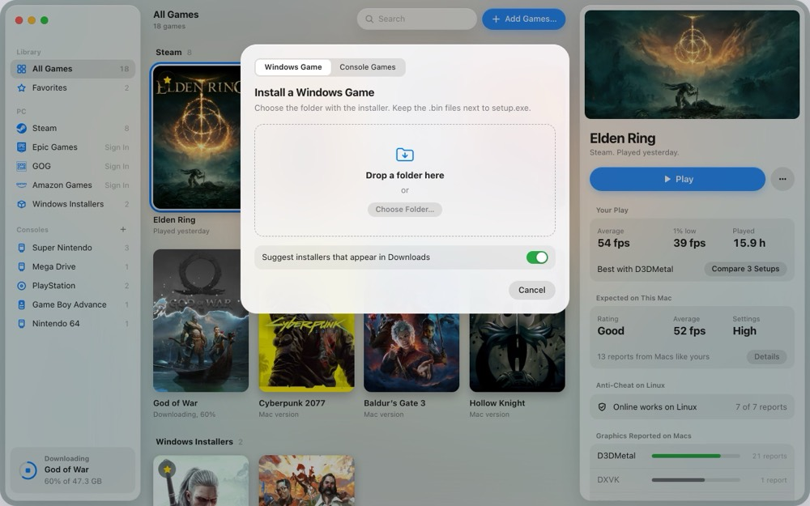
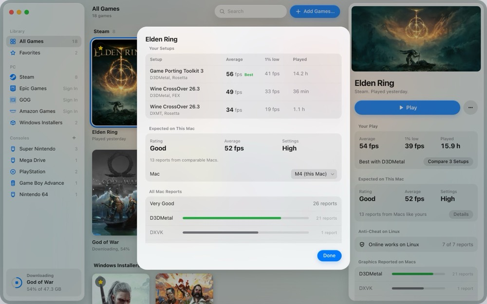
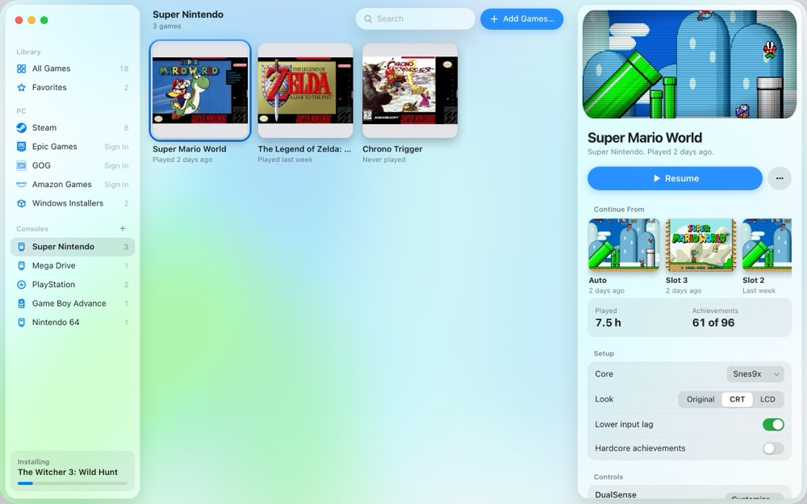
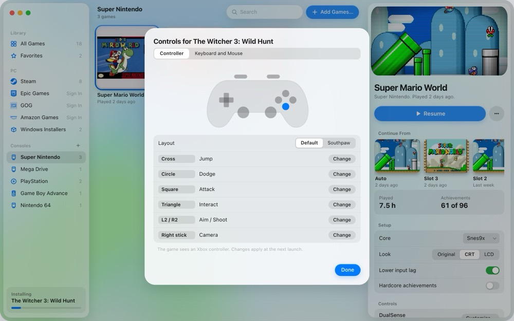
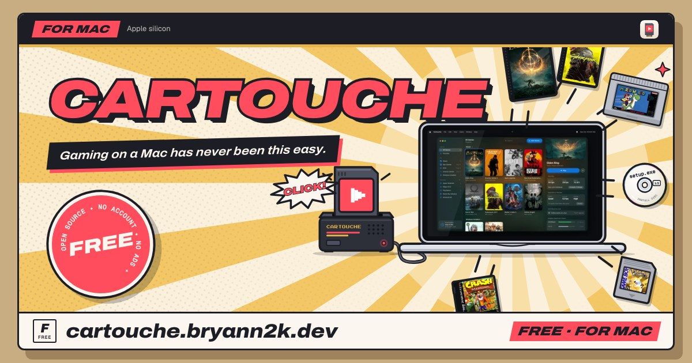

<p align="center">
  <picture>
    <source media="(prefers-color-scheme: dark)" srcset="docs/readme/icon-dark.svg">
    
  </picture>
</p>

<h1 align="center">Cartouche</h1>

<p align="center">
  <b>A free game launcher for Apple silicon Macs.</b><br>
  Windows games from Steam, Epic, GOG, Amazon or an installer, and your console games, in one library.
</p>

<p align="center">
  <a href="https://cartouche.bryann2k.dev">Website</a>
  ·
  <a href="https://cartouche.bryann2k.dev/games">Games guide</a>
  ·
  <a href="#install">Install</a>
  ·
  <a href="docs/ROADMAP.md">Roadmap</a>
  ·
  <a href="CONTRIBUTING.md">Contributing</a>
  ·
  <a href="https://ko-fi.com/bryann2k">Support</a>
</p>

<p align="center">
  
  
  <a href="LICENSE"></a>
  <a href="https://ko-fi.com/bryann2k"></a>
</p>

<p align="center">
  <picture>
    <source media="(prefers-color-scheme: dark)" srcset="docs/readme/library-dark.jpg">
    
  </picture>
</p>

> [!IMPORTANT]
> **Cartouche 0.1.0 is in validation and not released yet.** This repository stays private until 0.1.0. Install links below start working with the first release. Expect missing features and breaking changes.

## Why Cartouche

- **One library.** Steam, Epic, GOG and Amazon games sit next to Windows installers and console games.
- **No account, no ads.** Cartouche is free and open source. Store sign-ins happen on each store's own page and the tokens stay in your Keychain.
- **Made for the Mac.** A native SwiftUI app with Liquid Glass, English, French, Italian and Simplified Chinese.
- **Honest about compatibility.** Each game shows its measured FPS, an estimate for your Mac and known anti-cheat problems.

## Features

<table>
  <tr>
    <td width="50%" valign="top">
      
      <h3>Add any game by dropping it</h3>
      Drop an installer, an installed game folder, a console ROM or an archive. Cartouche detects what it is. Bundled libarchive opens zip, 7z, tar and supported RAR files. Installs are verified by checksum or size, and you can check them again later.
    </td>
    <td width="50%" valign="top">
      
      <h3>Know before you play</h3>
      FPS is measured per session and per setup. Compare Setups shows which runner and graphics backend work best. The panel adds a MacGamingDB estimate for your Mac and community reports.
    </td>
  </tr>
  <tr>
    <td width="50%" valign="top">
      
      <h3>Consoles, built in</h3>
      A bundled RetroArch runs your console games. Cores download per console. Standalone emulators like Dolphin are used when installed. Netplay, RetroAchievements, save states and iCloud Drive saves are included.
    </td>
    <td width="50%" valign="top">
      
      <h3>Controller first</h3>
      A live controller diagram, per-game remapping, Steam Input and couch mode. Keyboard-only games can be played with a controller.
    </td>
  </tr>
</table>

### Windows games

- **Cartouche Wine**, built from CodeWeavers' CrossOver 26.3 sources, is the recommended runner. CrossOver.app is optional.
- **Graphics backends** per game: D3DMetal, DXMT and DXVK. D3DMetal comes only from your own copy of Apple's Game Porting Toolkit; Cartouche never ships it.
- **Steam Play inside Mac Steam.** Cartouche enables the Steam Play support already present in macOS Steam and adds its runners as Steam compatibility tools.
- **Advanced options** only where the setup supports them: MetalFX upscaling, AVX advertisement, MSync, high resolution and the Metal HUD.
- **Starts With** changes the program an installed game launches. **Wine Prefixes** in Settings back up and restore each game's prefix.
- **Wine Tools** in the game menu run Winetricks or a program in the game's prefix, open its C: drive and show its log.
- **Games location** in Settings > Library sets where new Windows and store games install. Games already installed keep working where they are.
- **A problem banner** reports failed store jobs, missing runners and games that exit early with an error, with Show Log and Copy Summary.

### For AI agents

Cartouche includes a local MCP server, `cartouche-mcp`. An agent can read your library, logs and crash reports, then propose or apply a fix.

```sh
claude mcp add cartouche -- cartouche-mcp
```

- **You set the level:** Read only, Standard or Full.
- **You approve** anything that installs, deletes or runs an exe.
- **You see every action** in Settings > Agents and can undo configuration changes.

## Install

Cartouche needs a **Mac with Apple silicon** and **macOS 15 or later**.

### Disk image

Download `Cartouche-<version>.dmg` from the [latest release](https://github.com/BRYANN2K/cartouche/releases/latest). Drag Cartouche to Applications. A `.zip` of the same app is published too.

<details>
<summary>First open: macOS asks once</summary>

1. macOS says it can't check Cartouche. Click Done.
2. Open System Settings > Privacy & Security, scroll down, click Open Anyway.
3. Confirm with your password. Updates won't ask again.

Cartouche is signed with its own certificate but not notarized, because notarization needs a paid Apple developer membership. The certificate keeps the app's identity stable, so updates install without a prompt and your permissions do not reset.

If you open Cartouche from the disk image or from Downloads, it offers to move itself to Applications first.

</details>

### Homebrew

```sh
brew install --cask bryann2k/cartouche/cartouche
```

### Install script

```sh
curl -fsSL https://raw.githubusercontent.com/BRYANN2K/cartouche/main/install.sh | sh
```

The script checks the archive against the release's `SHA256SUMS` and refuses an app signed with another certificate. It skips the first-open warning because curl does not quarantine the download.

### Updates and betas

- **Sparkle** checks for signed updates in the app.
- **Betas:** turn on Settings > Receive beta updates.
- **Branches:** `main` holds releases, `beta` holds betas.

## Compatibility notes

- **Anti-cheat varies by game.** Cartouche shows known incompatibilities. Reports of online play on Linux do not prove a game works on a Mac.
- **NTFS drives are not supported** for games.
- **Native Mac versions win in Steam.** To get the Windows version, force a compatibility tool in the game's Steam Properties > Compatibility.
- **Data stays separate.** Files live in `~/Library/Application Support/Cartouche` and logs in `~/Library/Logs/Cartouche`.
- **Crash reports stay local.** Nothing is sent unless you share it. See [PRIVACY.md](docs/PRIVACY.md).

## Website and games guide

<a href="https://cartouche.bryann2k.dev"></a>

[cartouche.bryann2k.dev](https://cartouche.bryann2k.dev) presents the app. Its [games guide](https://cartouche.bryann2k.dev/games) reads like a game's instruction booklet: performance by Mac model, setup, reports, fixes and anti-cheat status.

## FAQ

<details>
<summary>Is Cartouche free?</summary>

Yes. Cartouche is GPL-3.0 software with no account, no ads and no paid tier. Donations on Ko-fi are optional.

</details>

<details>
<summary>Do I need CrossOver?</summary>

No. Cartouche Wine is free and recommended. An installed CrossOver.app also works.

</details>

<details>
<summary>Where do I check if a game runs?</summary>

The [games guide](https://cartouche.bryann2k.dev/games) lists results by Mac model. In the app, the game panel shows the estimate for your Mac.

</details>

<details>
<summary>Does Cartouche ship emulators or games?</summary>

No games. RetroArch is bundled; other emulators are detected and launched with your own game files.

</details>

## Build from source

The app is a Swift package in `app/`. The Steam-side code is in `dylib/`, `lsteamclient/`, `steam-shim/` and `ntdll-patch/`.

```sh
git clone --recurse-submodules https://github.com/BRYANN2K/cartouche.git
cd cartouche
make app
```

Read [CONTRIBUTING.md](CONTRIBUTING.md) before a pull request. Design and decisions are in [PRD](docs/PRD.md), [TRD](docs/TRD.md) and [the ADRs](docs/adr/). Report a vulnerability privately, as described in [SECURITY.md](SECURITY.md).

## Support

Cartouche is built and maintained by one developer. If it helps you play on your Mac, you can support its work on Ko-fi.

<a href="https://ko-fi.com/bryann2k"></a>

Questions and game reports are welcome on [Discord](https://discord.gg/fKxanZyFea) and in [issues](https://github.com/BRYANN2K/cartouche/issues).

## Credits

Cartouche started as a fork of [NotProton](https://github.com/NotProtonNot/NotProton) 1.2.0, created by NotProtonNot with the NotProton contributors. Its Steam Play design and much of the Steam-side code are theirs, and the first commit of this history imports that work as is.

Cartouche also stands on:

- [Wine](https://www.winehq.org) and [CodeWeavers](https://www.codeweavers.com)' CrossOver sources (LGPL), for Cartouche Wine. Build recipes are public in [cartouche-wine](https://github.com/BRYANN2K/cartouche-wine).
- Valve's [Proton](https://github.com/ValveSoftware/Proton) components: lsteamclient, steam_helper and fonts.
- [DXMT](https://github.com/3Shain/dxmt), [DXVK](https://github.com/doitsujin/dxvk) and [Gcenx](https://github.com/Gcenx)'s macOS builds, plus Apple's Game Porting Toolkit and D3DMetal, which you supply.
- [RetroArch](https://www.retroarch.com) and libretro cores, [Sparkle](https://sparkle-project.org), libarchive, innoextract, legendary, gogdl, comet and nile.
- [MacGamingDB](https://macgamingdb.app) for per-Mac estimates.
- The NotProton author's thanks go on to [Kaon](https://github.com/natbro/kaon), [Neutron](https://github.com/mont127/Neutron) and [Gio](https://github.com/giodotblue).

The full list with licenses is in [NOTICE](NOTICE) and [THIRD-PARTY-LICENSES](THIRD-PARTY-LICENSES).

## License

Cartouche is free software, licensed under the GNU General Public License version 3 (GPL-3.0), like NotProton. See [LICENSE](LICENSE). Some parts keep their original authors' licenses, listed in NOTICE and THIRD-PARTY-LICENSES.

Cartouche is now its own project, not built on NotProton. It is not affiliated with NotProton, Valve, Apple or CodeWeavers. Platform and game names and artwork belong to their owners and are shown only to identify them.
