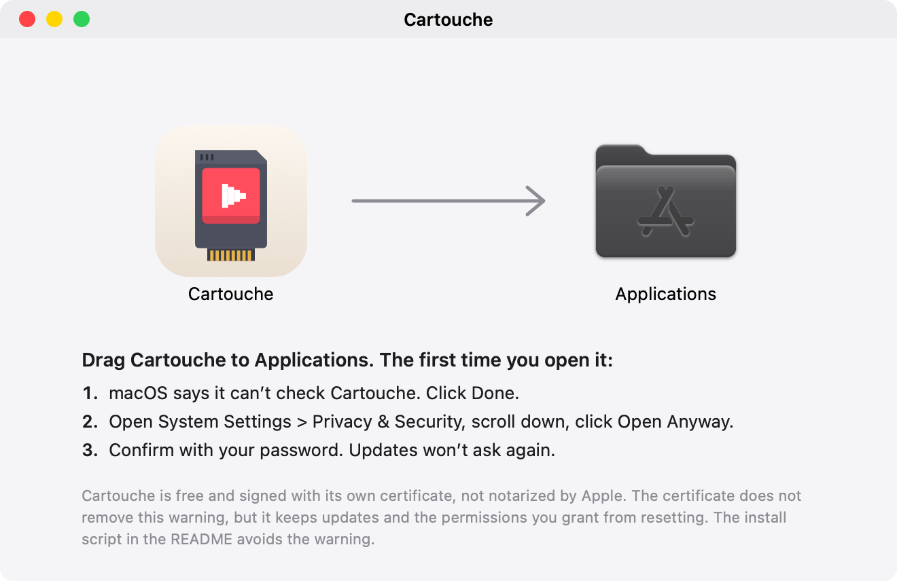

# Cartouche

Cartouche is a free macOS game launcher for Apple silicon Macs. It runs Windows games through Steam Play inside the Mac Steam client, through Epic, GOG and Amazon, or from a Windows installer. It also plays console games through its own bundled RetroArch.

Cartouche started as a fork of [NotProton](https://github.com/NotProtonNot/NotProton) and is now its own project; it is not built on NotProton. Agent control through MCP is merged (P11). The app repository stays private until v0.1.0; Cartouche Wine, our Wine build from CodeWeavers' CrossOver sources (LGPL), has its recipes and assets public in [cartouche-wine](https://github.com/BRYANN2K/cartouche-wine). The website is [cartouche.bryann2k.dev](https://cartouche.bryann2k.dev).

**Status: early development.** There is no release yet. Expect missing features and breaking changes.

## Install

Cartouche needs a Mac with Apple silicon and macOS 15 or later.

### Disk image

Download `Cartouche-<version>.dmg` from the [latest release](https://github.com/BRYANN2K/cartouche/releases/latest) and drag Cartouche to Applications. The first time you open it, macOS 15 and 26 block it once:

1. macOS says it can't check Cartouche. Click Done.
2. Open System Settings > Privacy & Security, scroll down, click Open Anyway.
3. Confirm with your password. Updates won't ask again.



If you open Cartouche straight from the disk image or from Downloads, it offers to move itself to Applications first. Permissions and updates are tied to that location.

### Homebrew

```sh
brew install --cask bryann2k/cartouche/cartouche
```

The tap installs the same signed app. The first open goes through the same three steps.

### Why macOS asks

Cartouche is free and signed with its own certificate. It is not notarized by Apple, because notarization needs a paid Apple developer membership. The certificate does not remove the first-open warning. It keeps Cartouche's identity the same across releases, so updates install without a prompt and the permissions you grant do not reset. The install script avoids the warning because curl does not mark the download as quarantined.

## Local Windows games

Drop an already-installed Windows game folder to use it in place (the default) or copy it. An in-place import never gives Cartouche ownership of the source files. Removing it from the library must not delete them.

Add Games accepts installers, installed-game folders, console ROMs and archives through one sheet or a window drop. Bundled libarchive handles zip/zip64, 7z, tar and supported RAR variants; encrypted archives are refused. Games extracted from a dropped archive move to the games location; Cartouche never keeps them in `~/Library/Caches`. Supported installers that unpack their data with their own helper programs can be extracted directly. If a direct unpack fails, Try Again runs the original setup under Wine. Output checks distinguish checksum/CRC verification, size-only checks and installed-but-not-verified games. Verify Files can check again later; mismatches offer a standard-method retry, Keep Anyway or Cancel.

Ranked identification, privacy-gated Steam cover search, PE-based runtime setup and managed-game uninstall are merged. Starts With changes the program an installed game launches. Cartouche Wine is recommended for new setups, without replacing explicit existing choices. Fresh initialization can take several minutes; games wait until it finishes. Real-game and clean-machine validation remains before release. See [the roadmap](docs/ROADMAP.md).

## What it does today

- Seven-step setup scans this Mac, recommends Cartouche Wine, imports your own Game Porting Toolkit disk image, connects stores and sets up consoles, controllers and permissions. Downloads continue in Activity while you move on; saved choices and pending work resume after relaunch.
- Settings gathers Steam integration, Wine versions, prefix backups and restoration, accounts, controllers and privacy. CrossOver.app is optional: Cartouche Wine builds also work as Steam compatibility tools. When Cartouche's install in Steam does not match the app, one Repair action fixes it (Quit Steam and Repair while Steam runs).
- Cartouche never ships D3DMetal. With Cartouche Wine, D3DMetal comes only from your own Game Porting Toolkit; Get D3DMetal… opens Settings > Runners, where the toolkit is imported.
- Windows games have per-game Advanced options only where supported: MetalFX upscaling, AVX advertisement, MSync, high resolution and Metal HUD. DLSS needs the supported DXMT extensions; there is no frame-generation switch.
- Steam downloads show progress with pause/resume and cancellation. Console removal distinguishes hiding library entries from moving owned game/emulator files to the Trash.
- English, French, Italian and Simplified Chinese UI; French copy follows the reviewed product glossary. Crash reports and diagnostic zips stay local.

The library lists your Steam, Epic, GOG and Amazon games next to your console games. Each Windows game keeps one installation when you change runners. Store sign-in happens on each store's own page; the tokens stay in the Keychain. Consoles run on a bundled RetroArch build (cores download per console) or on standalone emulators. Adding a console game installs its missing runtime automatically; existing emulators are reused. Netplay, RetroAchievements, per-game controls and couch mode are in. FPS is measured per session and per setup; a MacGamingDB estimate and community compatibility data sit on the game panel.

Underneath, Cartouche forcibly enables the Steam Play functionality in macOS Steam (which is present and inert) and ports some components of Valve's Proton to macOS. This builds on NotProton's original design, with Cartouche's runner registry and Steam export integration.

It is intended to be used with the stable Steam Client (version 1791918634) as well as the beta Steam Client (version 1792192922) paired with **CrossOver 26.3 or CrossOver [Preview](https://www.codeweavers.com/preview) 20261006 / 20260821 / 20261015**.

**NTFS file systems/drivers are not currently supported.**

Both the FEX and the Rosetta versions of CrossOver are supported. The FEX version of Preview 20261006 includes both the FEX and the Rosetta versions.

A good default is to go into Steam Settings - Compatibility and select the Rosetta version as your default compatibility tool. You can select FEX on a per game basis by right clicking a game in Steam, going into Properties - Compatibility and selecting FEX there.

If a game has a native macOS version as well as a Windows one, Steam will download the macOS version. To override this behavior, right click on the game, select Properties, select Compatibility. Enable 'Force the use of a specific Steam Play compatibility tool'. Select whichever version of CrossOver you want to use. That will make Steam download the Windows version. Unchecking the 'Force the use...' box or selecting 'No Compatibility Tool' in the drop down list will revert to the macOS version of the game, with the specifics there varying based on your Steam version.

**Anti-cheat support varies by game.** Cartouche shows known incompatibilities and links to ProtonDB multiplayer reports. Reports of successful online play do not establish anti-cheat support in Cartouche; unverified games remain marked as unverified.

Cartouche keeps its files in `~/Library/Application Support/Cartouche` and its logs in `~/Library/Logs/Cartouche`, so it does not share them with a NotProton install on the same Mac.

## Developer notes

The macOS app is located in the `app` folder. The core logic is in `dylib`.
`lsteamclient` is a macOS port of Valve's lsteamclient. `steam-shim` is a port of Valve's
steam-helper from Proton 9.0. `ntdll-patch` patches the copy of CrossOver that the app
makes/places in the `~/Library/Application Support/Cartouche/runners/` folder so that
lsteamclient is loaded. `tools/make-icon.swift` builds the app icon from `mockup/brand`.

## Credits

Cartouche started as a fork of [NotProton](https://github.com/NotProtonNot/NotProton), created by NotProtonNot with the NotProton contributors. Most of the code in this repository is theirs.

The NotProton author also thanks the people who worked on similar ideas before it:

- [Nat Brown](https://github.com/natbro) made [Kaon](https://github.com/natbro/kaon), which is similar in goals to NotProton.
- mont127's [Neutron](https://github.com/mont127/Neutron) is also a similar idea, but implemented differently.
- [Gio](https://github.com/giodotblue) was working on enabling Steam Play inside of Steam on macOS prior to the release of NotProton itself.

And everyone who has positively contributed to macOS gaming.

## License

Cartouche is free software, licensed under the GNU General Public License version 3 (GPL-3.0), like NotProton. See LICENSE. Some parts carry the licenses of their original authors (Valve, the Steamworks SDK, Sparkle, fonts and others); NOTICE and THIRD-PARTY-LICENSES list them. What Cartouche asks macOS for and what it sends over the network is in docs/PRIVACY.md.

Cartouche is now its own project, not built on NotProton. It is not affiliated with NotProton, Valve, Apple or CodeWeavers. Platform names and logos shown in the app belong to their owners and are only used to identify the platforms.
